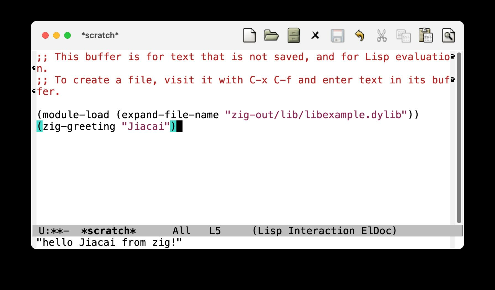

#+TITLE: Zig-emacs
#+DATE: 2023-12-24T12:27:53+0800
#+LASTMOD: 2026-11-14T11:50:30+0800
#+OPTIONS: toc:nil num:nil

[[https://github.com/jiacai2050/zig-emacs/actions/workflows/ci.yml][https://github.com/jiacai2050/zig-emacs/actions/workflows/ci.yml/badge.svg]]
[[https://github.com/jiacai2050/zig-emacs/actions/workflows/lisp-ci.yml][https://github.com/jiacai2050/zig-emacs/actions/workflows/lisp-ci.yml/badge.svg]]
[[https://img.shields.io/badge/zig%20version-0.17.0-blue.svg]]

~zig-emacs~ provides idiomatic, high-performance Zig bindings for GNU Emacs [[https://www.gnu.org/software/emacs/manual/html_node/elisp/Writing-Dynamic-Modules.html][dynamic modules]].

* Features

- *Zero Header Setup*: Automatically translates bundled ~include/emacs-module.h~ via Zig's ~addTranslateC~ during build.
- *Type-safe User Pointers*: Wrap arbitrary Zig structs with typed helpers and automatic finalizers tied to Emacs GC.
- *Non-blocking Async Streaming*: Send streaming data from native background threads directly into Emacs ~make-pipe-process~ via ~openChannel~ without blocking the editor UI.
- *Idiomatic Error Handling*: Seamless mapping between Zig error unions and Emacs non-local exits (~signal~ and ~throw~).

* Requirements

- Zig 0.17.0 or newer
- GNU Emacs 28 or newer

* Installation

Add ~zig-emacs~ to your ~build.zig.zon~:

#+begin_src bash
# Latest commit
zig fetch --save git+https://github.com/jiacai2050/zig-emacs.git

# Tagged release
zig fetch --save git+https://github.com/jiacai2050/zig-emacs.git#v0.3.0
#+end_src

Then import it in your ~build.zig~:

#+begin_src zig
const emacs_dep = b.dependency("emacs", .{
    .target = target,
    .optimize = optimize,
});
module.addImport("emacs", emacs_dep.module("emacs"));
#+end_src

* Quickstart

Every module must call ~moduleInit~ at comptime and provide an ~init~ function. Registered functions accept ~emacs.Env~ as their first argument and return ~emacs.Value~ or ~!emacs.Value~.

#+begin_src zig
const std = @import("std");
const emacs = @import("emacs");

comptime {
    emacs.moduleInit(@This());
}

fn add(env: emacs.Env, lhs: emacs.Value, rhs: emacs.Value) emacs.Value {
    return env.makeInteger(
        env.extractInteger(lhs) + env.extractInteger(rhs),
    );
}

pub fn init(env: emacs.Env) c_int {
    env.makeFunction(
        "zig-add",
        add,
        .{
            .doc_string = "Add two integers.",
            .interactive_spec = "nFirst number: \nnSecond number: ",
        },
    ) catch return 1;

    return 0;
}
#+end_src

Build the module and load it in Emacs:

#+begin_src emacs-lisp
(add-to-list 'load-path "/path/to/zig-emacs/zig-out/lib/")
(load "libzig-example")
(zig-add 1 2)
#+end_src

* Core Guides

** Allocator Context & User Data

Emacs ~Env~ does not manage memory allocators. Pass application state via ~FuncContext.user_data~ and retrieve it with ~getUserData~:

#+begin_src zig
const ModuleContext = struct {
    gpa: std.mem.Allocator,
};

var module_context: ModuleContext = .{
    .gpa = std.heap.smp_allocator,
};

fn greeting(env: emacs.Env, value: emacs.Value) !emacs.Value {
    const context = env.getUserData(ModuleContext) orelse return error.MissingModuleContext;
    const text = try env.extractString(context.gpa, value);
    defer context.gpa.free(text);
    return env.makeString(text);
}

pub fn init(env: emacs.Env) c_int {
    env.makeFunction(
        "zig-greeting",
        greeting,
        .{ .user_data = @ptrCast(&module_context) },
    ) catch return 1;
    return 0;
}
#+end_src

** Typed User Pointers

Bind native state directly to Emacs Lisp values with optional garbage-collection finalizers:

#+begin_src zig
const Resource = struct {
    gpa: std.mem.Allocator,

    fn deinit(self: *Resource) void {
        self.gpa.destroy(self);
    }
};

fn makeResource(env: emacs.Env, gpa: std.mem.Allocator) !emacs.Value {
    const resource = try gpa.create(Resource);
    resource.gpa = gpa;
    return env.makeUserPointer(Resource, resource, Resource.deinit);
}

fn useResource(env: emacs.Env, value: emacs.Value) emacs.Value {
    const resource = env.getUserPointer(Resource, value) orelse return env.nil;
    _ = resource;
    return env.t;
}
#+end_src

Pass ~null~ as the finalizer callback for unmanaged or borrowed pointers.

** Calling Emacs Functions & Error Handling

Invoke any Emacs Lisp function with ~Env.funcall~, which automatically detects signals and throws:

#+begin_src zig
var args = [_]emacs.Value{env.makeString("Hello from Zig!")};
const result = try env.funcall("message", &args);
#+end_src

Convenience wrappers are available:
- ~env.message(str)~: Print directly to the echo area / ~*Messages*~ buffer.
- ~env.reportError(prefix, err)~: Call the Emacs ~error~ function.
- ~env.signal(err, args)~: Raise an Emacs signal from a Zig error.

** Native Types, Sequences & Object Wrappers

~zig-emacs~ provides rich, object-oriented Zig structs for manipulating Emacs data structures without low-level C-ABI boilerplate:

#+begin_src zig
// 1. Pattern matching on Emacs value types
switch (env.getType(val)) {
    .integer => { const n = env.extractInteger(val); },
    .string => { const s = try env.extractString(allocator, val); },
    .nil => { ... },
    else => { ... },
}

// 2. Unified Sequence (accepts both Emacs Vector and List!)
if (env.toSequence(val)) |seq| {
    const len = try seq.len();
    const items = try seq.toSlice(allocator);
    defer allocator.free(items);
}

// 3. Object-oriented Vector
const vec = try emacs.Vector.create(env, &[_]emacs.Value{ a, b });
const first_item = vec.get(0);
vec.set(1, c);

// 4. Object-oriented List
const list = try emacs.List.create(env, &[_]emacs.Value{ a, b });
const head = try list.car();
const tail = try list.cdr();

// 5. Type-safe UserPointer handle
const MyHandle = emacs.UserPointer(MyResource);
const handle = MyHandle.create(env, res, MyResource.deinit);
// Or wrap an existing user pointer value:
// const handle = MyHandle.init(env, user_ptr_val);
if (handle.getChecked(MyResource.magic)) |res_ptr| {
    res_ptr.doWork();
}
handle.deinit(); // sets user-ptr to null
#+end_src

** Non-blocking Async Streaming

~openChannel~ binds native code to the write end of an Emacs ~make-pipe-process~. This allows background threads to stream results without locking the main Emacs UI:

#+begin_src emacs-lisp
(let ((process
       (make-pipe-process
        :name "zig-stream"
        :buffer nil
        :filter (lambda (_proc chunk)
                  (message "Received: %s" chunk)))))
  (zig-start-stream process))
#+end_src

On the Zig side:

#+begin_src zig
const Worker = struct {
    channel: emacs.Channel,

    fn run(self: *Worker) void {
        defer {
            var ch = self.channel;
            ch.deinit() catch {};
        }
        // Writes run concurrently in a background thread
        self.channel.write("part 1\n") catch return;
        self.channel.write("part 2\n") catch return;
    }
};

fn startStream(env: emacs.Env, proc_val: emacs.Value) !emacs.Value {
    const channel = try env.openChannel(proc_val);
    // Move channel into background worker thread...
    return env.t;
}
#+end_src

* Included Plugins

This repository includes practical plugins in [[file:plugins/][plugins/]] demonstrating real-world usage:

| Plugin | Path | Description |
|---|---|---|
| [[file:plugins/zig-fuzzy/README.md][zig-fuzzy]] | ~plugins/zig-fuzzy/~ | High-performance fuzzy matching & candidate sorting for completion |
| [[file:plugins/zig-shelf/README.md][zig-shelf]] | ~plugins/zig-shelf/~ | In-memory KV cache with native async thread streaming via ~openChannel~ |
| [[file:plugins/zig-sqlite/README.md][zig-sqlite]] | ~plugins/zig-sqlite/~ | Embedded SQLite database aligned with Emacs 29+ builtin APIs and polyfill support |

* Development & Testing

#+begin_src bash
# Build core modules (zig-example, zig-fuzzy, zig-shelf)
make build

# Build all modules including the optional zig-sqlite plugin
make build-all
# Or directly with Zig:
zig build -Denable-sqlite=true

# Run all test suites (module ERT tests + plugin ERT tests + Zig unit tests)
make test

# Format and lint code
make lint

# Generate documentation
make docs
#+end_src

* Docs

API documentation: https://jiacai2050.github.io/zig-emacs/

* License

[[file:LICENSE][MIT]]
